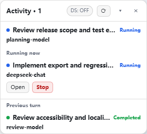

# DSH Agent Activity

[简体中文](./README.zh-CN.md) · [DS execution guide](./docs/ds-execution.md)

A lightweight main/direct-child activity panel for DeepSeek Harness, with actual execution models and an **optional DS execution switch**. No new model tools, progress-reporting prompts, replacement sidebar, raw HTTP endpoint or ASAR patch.

**0.1.0 is an early preview release.** Source: [O-OII/dsh-agent-activity](https://github.com/O-OII/dsh-agent-activity). This is GitHub source distribution, not an npm publication or a real-Host compatibility certification.



*Actual client bundle rendered with synthetic public adapters; not a live DSH session. The compact English switch reads DS: OFF / DS: ON; its tooltip and accessible name spell out the execution policy.*

## What makes it useful

- **Actual, not queued models:** display comes strictly from `modelSelection.lastUsed`. A `next` selection is never presented as a model that already ran. Provider and reasoning identities remain literal in hover text.
- **Current / previous turn focus:** the main agent stays visible; only running direct children appear in the current section. Previous-turn entries come from a bounded Host projection, not timestamp guesses or tree depth. An ended child is only “Completed” with durable completion evidence.
- **Low noise:** one compact 300px overlay, collapse/hide, no IDs or persistent dashboards. RPC concurrency is bounded at two; 3-second polling applies only to running children (and a running unretained root); ended visible entries get a one-time read and bounded settlement retries.
- **Native authority:** Open navigates to the official child address. Two-click Stop is offered only for a running, local, continuable direct child and calls official `interruptByParent(childId, parentId, "continuable")`. It does not invent root or external-task Stop permissions.
- **DS execution, when you choose:** a package-local optional routing companion can direct **future matching delegations** to a user-configured execution provider/model. Default OFF; no target/provider credentials are shipped. “DS execution” is a friendly UI name, not a restriction to DeepSeek. See the [full contract](./docs/ds-execution.md).

## Installation

Prerequisites: DSH Web/Desktop exposing the 0.2.1-rc.2 plugin contracts, and a profile where you may install packages. The release targets that API baseline; **verification includes Node tests and actual-client browser fixtures, not a live DSH Host or its transport**. Future releases may break the wrapping seam.

Install a source checkout with the CLI shipped by your intended DSH installation:

```sh
git clone https://github.com/O-OII/dsh-agent-activity.git
cd dsh-agent-activity
dsh plugin --profile desktop add --ignore-scripts .
```

The official installer selects the bundle and installs its declared runtime dependency. You do not need the React demo development dependencies for normal installation. Do not manually overwrite an existing profile manifest. For development/package checks use `npm ci --ignore-scripts`, `npm run check`, `npm test` and `npm run pack:smoke`. The [bundle patch](./cordis.patch.yml) mounts the panel and an optional routing companion **OFF, with no target**. Enable/reload through normal DSH lifecycle; refresh the existing GUI after client changes. This project does not start or replace a DSH server.

### Panel-only composition

Disable the companion with a profile override, keeping the panel intact:

```yaml
- id: planner-executor-routing
  disabled: true
```

Or compose only the panel package entry in your own patch:

```yaml
- insert:
    - id: subagent-activity
      name: dsh-agent-activity
```

Do not enable both this bundle and the old local activity/routing copies at once: the stable entry ids, settings namespace and projection key intentionally remain compatible, and duplicate owners conflict. The panel does not import the routing module and remains useful without it. Its switch then reports **unavailable**, not OFF.

## Language

English and Simplified Chinese cover visible copy, labels, status, errors, tooltips, accessibility labels and settings-schema descriptions. The browser uses the public `locale.register`, `getSnapshot`, `subscribe`, and `bind` API through an optional Cordis child. DSH locale changes re-render the panel; no `document.lang`-only guess and no localStorage preference.

Default `auto` follows DSH. Missing/unsupported locale service falls back to English. To pin the panel, merge this into the profile patch:

```yaml
- id: subagent-activity
  config:
    locale: zh-CN  # auto | en | zh-CN
```

This override is read through official Settings; panel locale revision fencing is independent of routing revisions. Low-level client compositions may also pass `config.locale` to the client plugin. Host routing errors use their own `locale` setting (`auto` = English on the Host). Provider/model ids, task text, tool names and external technical details are reference identities, not translated product copy.

## Compatibility and verification

| Area | Current evidence |
| --- | --- |
| Intended DSH API | 0.2.1-rc.2: session projections, `shell.overlay`, official remote settings/subagents and `startActivation` |
| Node | Windows Node 22.22.3 offline checks; CI matrix declares Node 22/24 on Windows/Linux, not a claim that CI already ran |
| Regression | Original 47 panel + 13 routing scenarios retained and adapted to package-local generic routes; release-specific tests added |
| GUI | Synthetic demo loads the real client bundle; **not real Host/GUI acceptance** |
| Real persistence / reload | Official contracts reviewed; current public package has not been validated with a real isolated Loader/ConfigEditor or live profile |

The historic machine-specific ASAR configuration-editor test is **not** shipped or counted. No ASAR implementation was copied. Follow [testing and demo instructions](./docs/testing.md) to reproduce the actual evidence and the remaining acceptance checklist.

## Alternatives, with respect for differences

DSH already has an [official subagent directory](https://github.com/deepseek-ai/deepseek-harness/tree/master/packages/client/ui-subagent) with navigation/status/Stop. This is not the first agent monitor or role router.

- [Mombrane/dsh-subagent-monitor](https://github.com/Mombrane/dsh-subagent-monitor): a direct monitor alternative with draggable cards and usage instruments.
- [edgeseeker7/dsh-subagent-progress](https://github.com/edgeseeker7/dsh-subagent-progress): richer progress detail and model-facing reporting guidance; different noise/behavior tradeoffs.
- [mirelconstantin/dsh-subagents-model](https://github.com/mirelconstantin/dsh-subagents-model): model visibility in multiple UI surfaces; this project instead commits to `lastUsed` and parent-turn groups.
- [thedeveloper256/dsh-model-router](https://github.com/thedeveloper256/dsh-model-router), [SnowAmberX/dsh-role-router](https://github.com/SnowAmberX/dsh-role-router), and [dingminhua/dsh-subagent-default-model](https://github.com/dingminhua/dsh-subagent-default-model): adjacent routing choices with different request-time/default/role policies.

Links are public reference points, not endorsements, copied implementation, a full market survey or a claim that competitors were tested in this run. Official model selection/default routing already exists; our optional policy is an exact-parent, new-delegation snapshot with an explicit switch.

## Privacy, boundaries and contributing

No telemetry, credentials, session snapshots, backups, private configuration or status files are part of the package. Bounded routing diagnostics stay in memory and do not contain prompts. See [Security](./SECURITY.md), [Contributing](./CONTRIBUTING.md) and [Changelog](./CHANGELOG.md). MIT © 2026 O-OII contributors.
