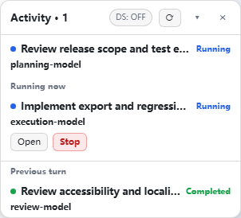
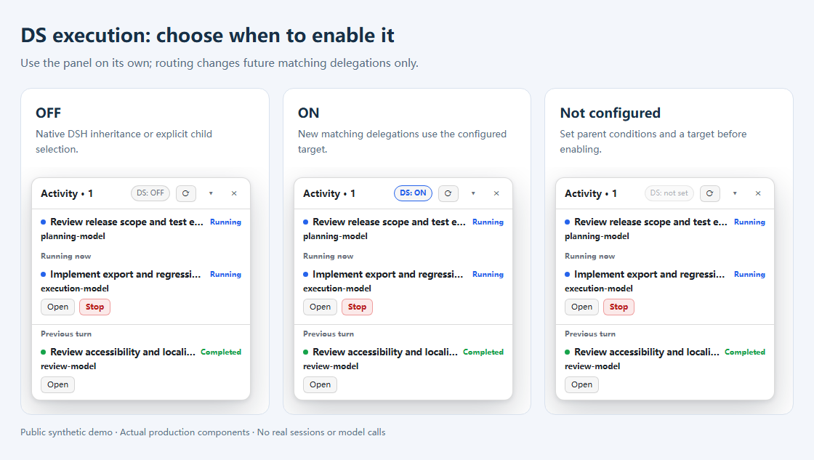
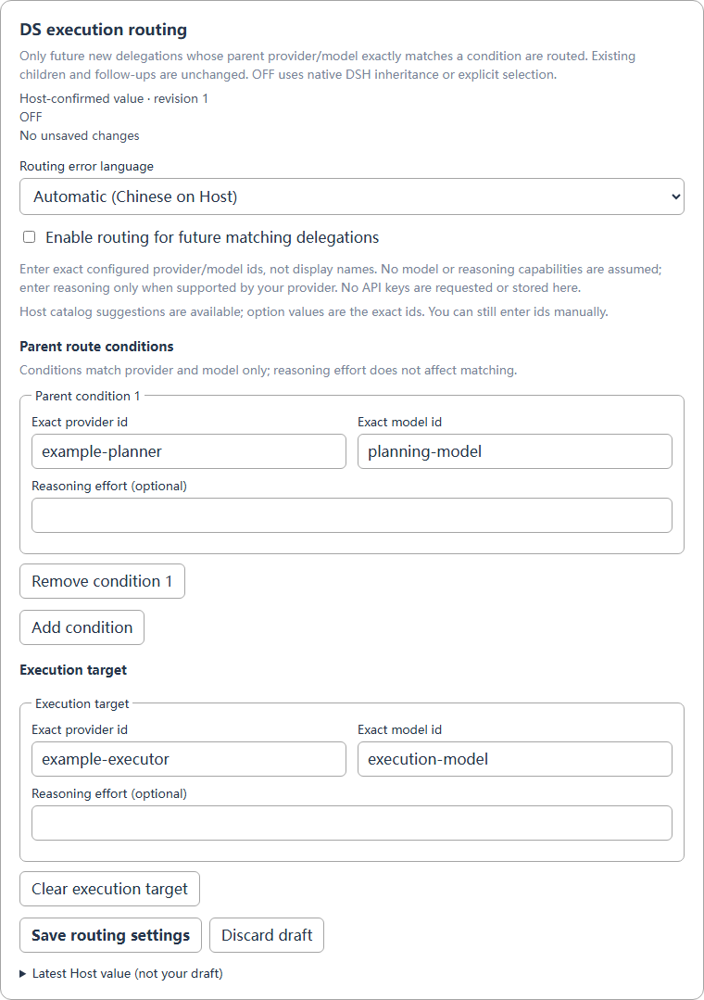

# DSH Agent Activity

[简体中文](README.zh-CN.md) · [Configuration](docs/configuration.md) · [DS execution](docs/ds-execution.md)

See your DeepSeek Harness main agent and direct children: **actual models, live status, current work and previous-turn results**.

- A compact overlay with collapse/hide and native child Open/Stop actions.
- Shows models that actually ran, not a queued model selection.
- Optional **DS execution** routes future matching delegations to your chosen execution model.
- Simplified Chinese by default; English and Follow DSH are available.

## Preview





*Actual plugin components with public demo data, not private sessions. DS execution is OFF by default.*

## Install

Requires Web/Desktop exposing the **DSH 0.2.1-rc.2 plugin APIs**. Use the CLI shipped by your intended DSH installation:

```sh
git clone https://github.com/O-OII/dsh-agent-activity.git
cd dsh-agent-activity
dsh plugin --profile desktop add --ignore-scripts .
```

Replace `desktop` for another profile, then refresh your existing DSH page. Disable old local activity/routing copies before enabling this bundle.

## Use and configure

1. Enable the installed bundle; the activity overlay appears automatically.
2. Open **Plugins → DSH Agent Activity (dsh-agent-activity)** for language and routing settings.
3. In **DS execution routing**, add parent conditions, a target and optional supported effort; save, then enable when needed.
4. The overlay switch follows confirmed settings. Each card saves independently; staged edits do not take effect.



**DS is a UI abbreviation, not a DeepSeek-only restriction.** Routing changes future matching delegations only, not existing children or in-flight work. Changing models can change costs and capabilities.

## More

- [Configuration and language options](docs/configuration.md)
- [Panel-only setup, migration and compatibility](docs/advanced.md)
- [Tests and screenshot reproduction](docs/testing.md)
- [Contributing](CONTRIBUTING.md) · [Security](SECURITY.md) · [Changelog](CHANGELOG.md)

[MIT License](LICENSE) · © 2026 O-OII contributors
