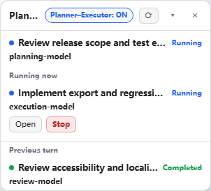
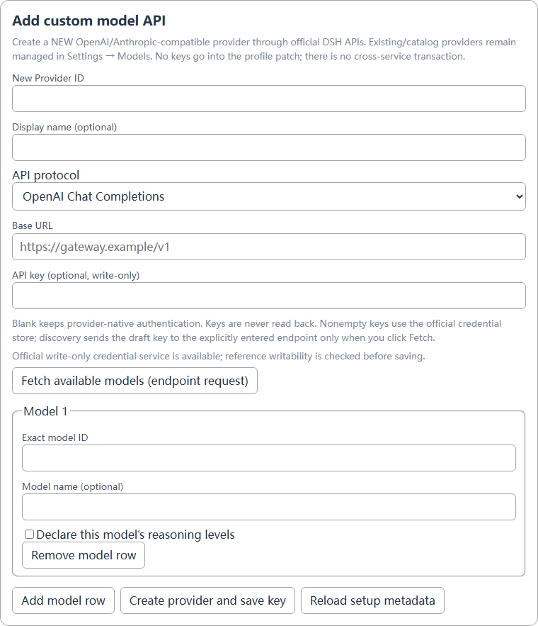
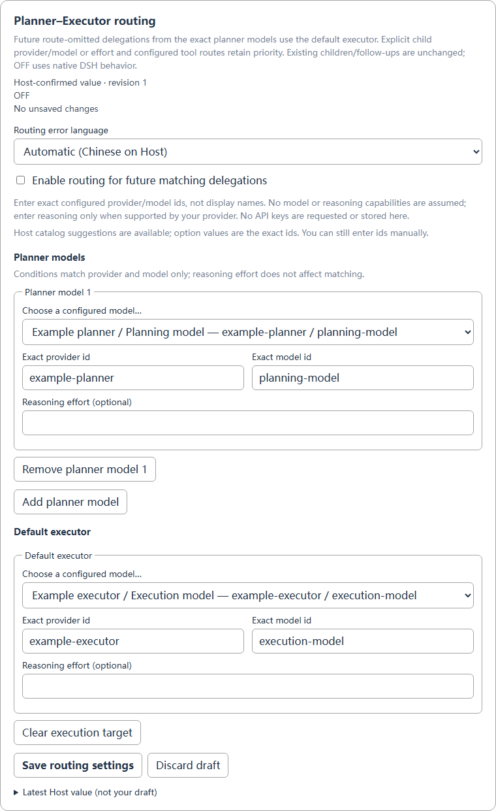

# DSH Planner–Executor

[简体中文](README.zh-CN.md) · [Setup](docs/configuration.md) · [Routing contract](docs/ds-execution.md)

**Let a capable main model plan, design, decide and accept results. Delegate substantial implementation, research and testing to a suitable API model; handle simple tasks directly.** Not DeepSeek-only. Package and settings IDs remain `dsh-agent-activity`, `subagent-activity` and `planner-executor-routing`.

- **Practical model setup:** create a custom OpenAI/Anthropic-compatible API provider, fetch or enter model IDs, declare per-model reasoning, and save keys through DSH’s official write-only credential service.
- **Clear roles:** select planner models and one default executor. Explicit child model/reasoning selections keep priority. Existing children are never migrated.
- **Useful observation:** actual models, running direct children, previous-turn results, native Open/Stop, collapse/hide.
- **Cost-aware, not cost-guaranteed:** concise worker scopes and acceptance evidence; prefer fresh workers to full-history forks. Delegation can reduce expensive-model execution, but may increase total tokens, latency or cost.

## Preview





*Screenshots use actual plugin components with public synthetic data, not private sessions or a paid model run. The strategy defaults OFF.*

## Install

Targets DSH APIs from **0.2.1-rc.2**, reviewed against **rc.3**; declared range `>=0.2.1-rc.2 <0.3.0` is not a certification of every build. Use your intended DSH installation’s CLI:

```sh
git clone https://github.com/O-OII/dsh-agent-activity.git
cd dsh-agent-activity
dsh plugin --profile desktop add --ignore-scripts .
```

Replace `desktop` for another profile, then refresh the existing DSH page. Disable old local activity/routing copies first. Nothing in this repository automatically installs, rewrites a live profile or restarts DSH.

## Three steps

1. Open **Settings → Plugins → DSH Planner–Executor**. In **Add custom model API**, enter a new Provider ID, protocol, Base URL, optional key and at least one exact model ID. Fetch is an explicit endpoint request; manual model IDs always remain available. Existing/catalog providers are managed in **Settings → Models**.
2. After Host-confirmed creation, choose the model under **Default executor**, and add the exact models allowed to act as planners. Configure runtime reasoning only when supported. Save routing separately; provider creation never enables it.
3. Enable **Planner–Executor** when needed. Only future, route-omitted delegations from matching **main** agents use the default executor. Explicit selections, configured tool routes and worker descendants remain native.



Setup requires the official `llm-pi-ai` namespace, schema and LLM directory services; credential/discovery availability is checked separately. Missing services and read-only/overlay refusals are shown honestly. No copied official editor component, private navigation, localStorage switch or custom secret endpoint is used.

## More

- [Model setup, credential failures and independent saves](docs/configuration.md)
- [Exact selection precedence, policy and limits](docs/ds-execution.md)
- [Panel-only setup, migration and compatibility](docs/advanced.md)
- [Reproducible tests and screenshot labels](docs/testing.md)
- [Contributing](CONTRIBUTING.md) · [Security](SECURITY.md) · [Changelog](CHANGELOG.md)

[MIT License](LICENSE) · © 2026 O-OII contributors
