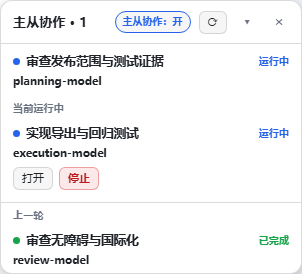
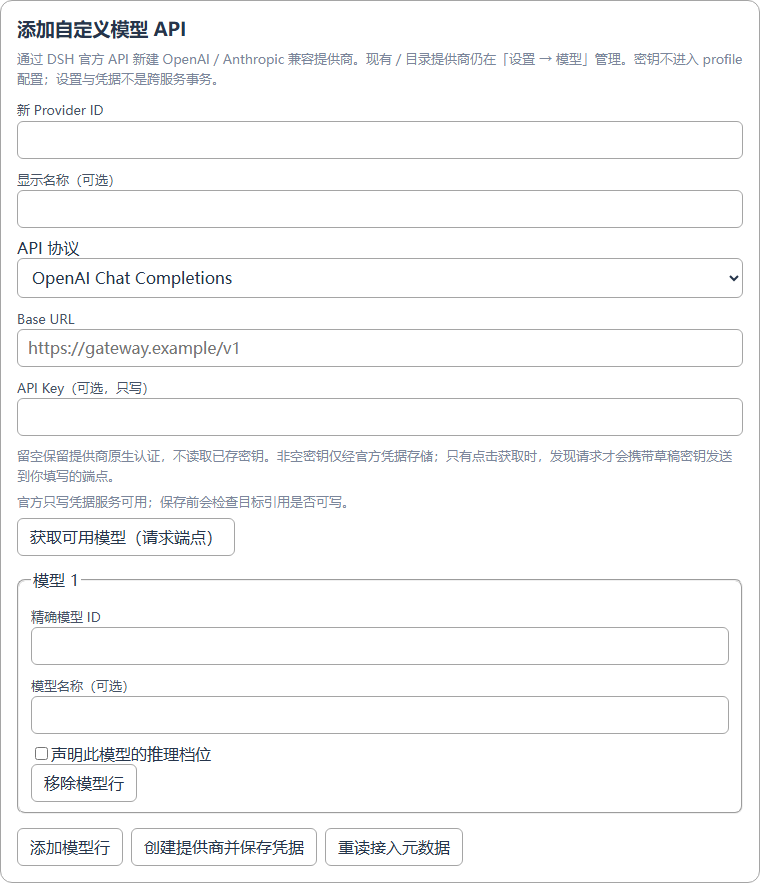
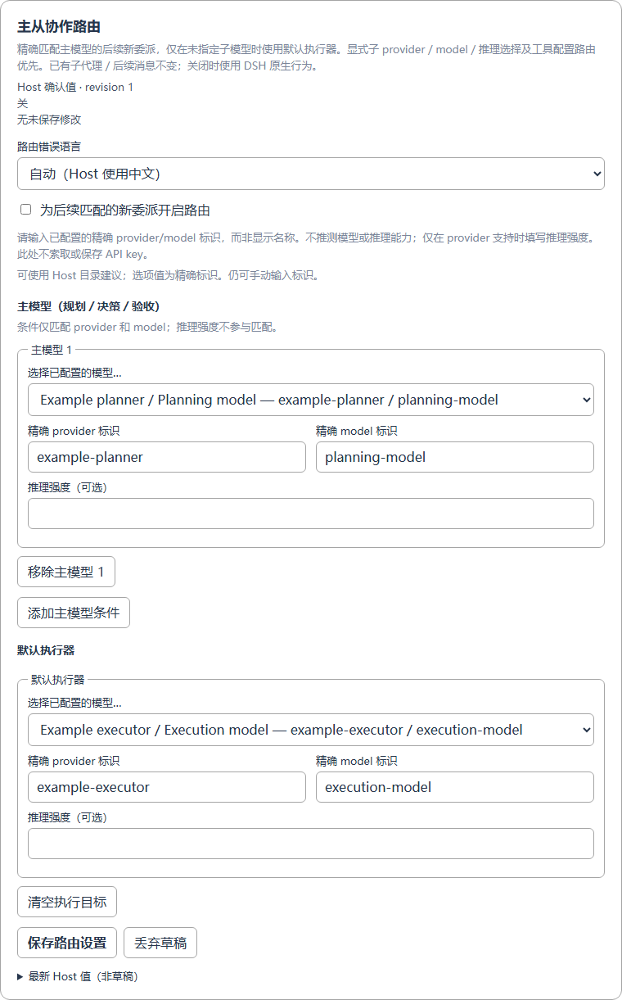

# DSH 主从协作

[English](README.md) · [配置指南](docs/configuration.zh-CN.md) · [路由契约](docs/ds-execution.zh-CN.md)

**强主模型负责规划、设计、决策和验收；实质实现、研究、测试交给合适的 API 模型，简单任务直接完成。** 不限 DeepSeek。包和设置 ID 保持 `dsh-agent-activity`、`subagent-activity`、`planner-executor-routing` 不变。

- **真正接入模型：** 新建 OpenAI／Anthropic 兼容 API 提供商，获取或手填模型 ID，声明逐模型推理档位；密钥通过 DSH 官方只写凭据服务保存。
- **角色明确：** 选择主模型与默认执行器；子代理显式模型／推理选择优先，不迁移已有任务。
- **看得见执行：** 实际模型、运行中的直接子代理、上一轮结果、原生打开／停止，可折叠隐藏。
- **控制负担，不承诺省钱：** 任务范围简洁，验收要实际证据，优先新建 worker 而非复制全部历史。可减少昂贵主模型的执行负担，但委派也可能增加总 token、延迟或费用。

## 效果





*图片使用真实插件组件与公开合成数据，不含私人会话，不代表收费模型调用验收。策略默认关闭。*

## 安装

目标 API 基线为 **DSH 0.2.1-rc.2**，已按 **rc.3** 复核接口；声明范围 `>=0.2.1-rc.2 <0.3.0` 不等于每个版本均已验收。使用目标 DSH 安装自带的 CLI：

```sh
git clone https://github.com/O-OII/dsh-agent-activity.git
cd dsh-agent-activity
dsh plugin --profile desktop add --ignore-scripts .
```

其他 profile 请替换 `desktop`，然后刷新原 DSH 页面。先停用旧本地面板／路由，避免重复加载。本仓库不会自动安装、覆盖现用配置或重启 DSH。

## 三步使用

1. 打开 **设置 → 插件 → DSH 主从协作**。在**添加自定义模型 API**中填写新 Provider ID、协议、Base URL、可选密钥与至少一个精确模型 ID。获取模型只在明确点击时请求端点；始终可以手填。已有／目录提供商仍在**设置 → 模型**管理。
2. 等待 Host 确认创建后，在**默认执行器**选择新模型，并添加允许担任规划者的精确主模型。仅在目标支持时选择运行时推理强度。路由另行保存，创建提供商不会自动开启策略。
3. 按需开启**主从协作**。只有匹配**主会话**后续新建、未指定子模型的委派使用默认执行器；显式选模、工具配置路由与 worker 的后代仍走原生行为。



自定义接入需要官方 `llm-pi-ai` 设置、schema 和 LLM 目录服务；凭据／模型发现可用性单独检查。缺服务、只读、覆盖层拒写都会明确提示。不抽取官方编辑器内部组件，不使用私有跳转、localStorage 开关或自建密钥端点。

## 更多

- [模型接入、凭据失败与独立保存](docs/configuration.zh-CN.md)
- [精确选模优先级、策略与边界](docs/ds-execution.zh-CN.md)
- [只使用面板、迁移与兼容性](docs/advanced.md)
- [测试复现与截图标注](docs/testing.md)
- [贡献指南](CONTRIBUTING.md) · [安全反馈](SECURITY.md) · [更新记录](CHANGELOG.md)

[MIT License](LICENSE) · © 2026 O-OII contributors
