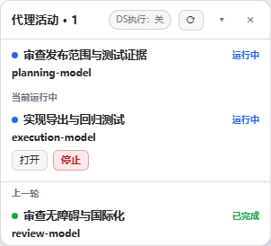
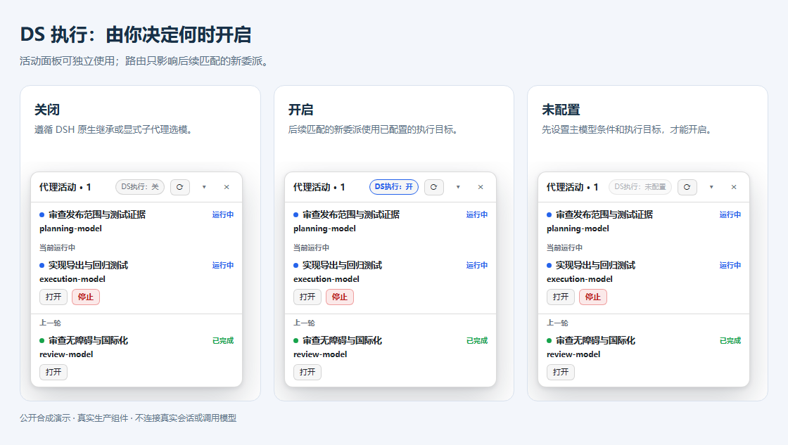
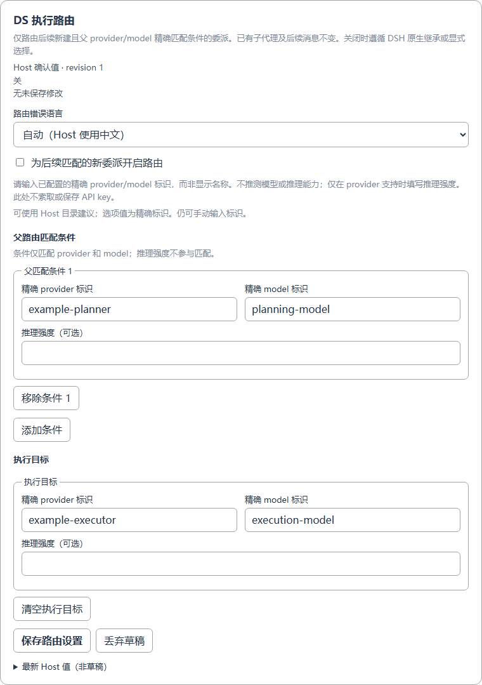

# DSH 代理活动面板

[English](README.md) · [配置指南](docs/configuration.zh-CN.md) · [DS 执行说明](docs/ds-execution.zh-CN.md)

在 DeepSeek Harness 中查看主代理和直接子代理的**实际模型、运行状态、当前与上一轮任务**。

- 轻量浮窗，可折叠、隐藏，直接打开或停止可操作的子代理。
- 展示已实际使用的模型，不把待生效选模当成执行结果。
- 可选 **DS 执行**：将匹配主模型的后续新委派交给指定执行模型。
- 默认简体中文，支持英文及跟随 DSH。

## 效果





*图片使用真实插件组件与公开演示数据，不包含私人会话。DS 执行默认关闭。*

## 安装

需要提供 **DSH 0.2.1-rc.2 对应插件 API** 的 Web／Desktop；使用当前 DSH 安装自带的 CLI：

```sh
git clone https://github.com/O-OII/dsh-agent-activity.git
cd dsh-agent-activity
dsh plugin --profile desktop add --ignore-scripts .
```

其他 profile 请替换 `desktop`。安装后刷新原 DSH 页面。旧本地面板／路由副本应先停用，避免重复加载。

## 使用与配置

1. 安装并启用后，活动浮窗自动显示；可直接查看代理状态。
2. 需要调整语言或路由时，打开 **插件 → DSH 代理活动面板（dsh-agent-activity）**。
3. 在 **DS 执行路由**中添加主模型条件、执行目标及可选推理强度，保存后再按需开启。
4. 浮窗开关与配置页同步；两张卡片独立保存，未保存修改不会生效。



**DS 是界面简称，不限 DeepSeek。** 路由只影响后续匹配的新委派，不迁移已有子代理或在途任务；执行模型可能改变费用与能力。

## 更多

- [完整配置与语言选项](docs/configuration.zh-CN.md)
- [只使用面板、迁移与兼容性](docs/advanced.md)
- [测试与截图复现](docs/testing.md)
- [贡献指南](CONTRIBUTING.md) · [安全反馈](SECURITY.md) · [更新记录](CHANGELOG.md)

[MIT License](LICENSE) · © 2026 O-OII contributors
