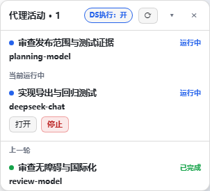

# DSH 代理活动面板

[English](./README.md) · [DS执行 专题](./docs/ds-execution.zh-CN.md)

面向 DeepSeek Harness 的轻量主/直接子代理活动面板，展示实际执行模型，附 **可选 DS执行 开关**。不注册额外模型工具，不要求代理自报进度，不替换官方侧栏，不新建裸 HTTP 接口，不修改 ASAR。

**0.2.1 为早期预览版，已增加中英文配置页。** 源码：[O-OII/dsh-agent-activity](https://github.com/O-OII/dsh-agent-activity)。本次为 GitHub 源码分发，不代表 npm 发布或真实宿主兼容认证。



*真实客户端代码配合公开合成适配器渲染，并非运行中的 DSH 会话；图中目标已配置并开启，仅用于说明，包默认关闭且未配置。*

## 价值与边界

- **实际，而非待生效模型**：严格取 `modelSelection.lastUsed`；不把 `next` 当成已经执行。provider/reasoning 标识保留原样，在悬停信息中显示。
- **当前 / 上一轮聚焦**：主代理常驻，当前区只列运行中的直接子代理；上一轮来自有界 Host 投影，不根据时间窗口或树深度猜测。只有持久完成证据才能显示“已完成”，否则为“未运行”。
- **低噪音**：300px 紧凑浮层，可折叠/隐藏，不展示 ID 或大仪表。RPC 并发上限 2；每 3 秒只轮询运行子代理和必要时运行中但未被保留的 root；上一轮可见 idle 行不轮询，仅补读与有界收尾重试。
- **官方权限**：打开使用正式 child address。两次点击确认 Stop，仅对运行中的本地 continuable 直接子代理出现，调用官方 `interruptByParent(childId,parentId,"continuable")`；不为主代理、外部任务杜撰停止能力。
- **自愿启用 DS执行**：包内独立可选路由可将**后续匹配的新委派**导向用户配置的执行 provider/model。默认关，不附带目标路由或凭据。“DS执行”是容易理解的界面名称，不限制为 DeepSeek。完整契约见[专题文档](./docs/ds-execution.zh-CN.md)。

## 安装

前提：DSH Web/Desktop 提供 0.2.1-rc.2 对应插件契约，且你有修改所选 profile 的权限。该版本是 API 目标基线；**本次包含 Node 测试与真实客户端的浏览器夹具验证，但不是运行中 DSH 宿主或真实传输验收**。未来 DSH 版本可能改变包装入口。

使用目标 DSH 安装自带的官方 CLI 安装源码目录：

```sh
git clone https://github.com/O-OII/dsh-agent-activity.git
cd dsh-agent-activity
dsh plugin --profile desktop add --ignore-scripts .
```

官方安装器会选择组合包并安装声明的运行依赖，普通安装不需要 React 演示开发依赖。不要手动覆盖现有 profile 清单。开发与打包检查可执行 `npm ci --ignore-scripts`、`npm run check`、`npm test`、`npm run pack:smoke`。[包内 patch](./cordis.patch.yml) 默认挂载面板与可选路由，路由**关且无 target**。按 DSH 正常生命周期启用/重载；客户端改变后刷新原 GUI。本项目不会启动或替换 DSH 服务器。

### 只装面板

保留包，使用 profile override 停用路由即可：

```yaml
- id: planner-executor-routing
  disabled: true
```

也可在自有 patch 中仅组合面板入口：

```yaml
- insert:
    - id: subagent-activity
      name: dsh-agent-activity
```

不要同时启用本包与旧本地面板/路由副本。为延续协议，entry id、settings namespace、projection key 保持稳定，重复 owner 会冲突。面板不 import 路由模块；没有路由时观察功能照常工作，开关明确显示**不可用**，而不是伪显示“关”。

## 在插件页配置

启用后打开 **插件 → DSH Agent Activity（代理活动面板）**。两张卡片分别保存**面板语言**与 **DS 执行**，这些设置不再要求手改 YAML。可配置多组精确主模型条件、执行目标、可选推理强度和错误语言；官方模型目录可用时提供辅助选择，否则保留手填标识。点击保存之前不会写入。

切换语言、外部更新和保存失败都不会清空草稿。Host revision 防止过期覆盖，冲突后需明确核对；关闭失败不会假装已停用路由。页面属于官方 `plugins.bundle.config` 组合包详情扩展点，不是全局设置的新分类；缺少插件配置页服务不阻塞浮窗挂载。


*真实生产表单代码的公开合成夹具，不是现用个人 profile。* 参见[配置步骤与错误处理](docs/configuration.zh-CN.md)。

## 国际化

英文、简体中文覆盖可见文案、状态、错误、title、aria-label 与设置 schema 描述。浏览器通过可选 Cordis child 接入公开 `locale.register/getSnapshot/subscribe/bind`；DSH locale 改变会更新 UI，不只猜测 `document.lang`，不把偏好放在 localStorage。

默认 `zh-CN` 为简体中文，不受 DSH 当前界面语言影响；显式 `en` 使用英文，显式 `auto` 跟随 DSH。服务缺失或语言不受支持时回退中文。通常直接在插件配置卡片选择面板语言；只有高级配置文件组合才需要把以下内容合并进 profile patch：

```yaml
- id: subagent-activity
  config:
    locale: zh-CN  # auto | en | zh-CN
```

覆盖由官方 Settings 读取，面板 locale 的 revision 栅栏独立于路由 revision。自定义低层客户端组合也可传入 client `config.locale`。Host 路由错误另有 `locale` 配置（Host 的 auto 回退中文）。provider/model、用户任务文字、工具名与外部技术错误细节是引用身份，不翻译。

## 兼容与证据

| 范围 | 本次证据 |
| --- | --- |
| 目标 DSH 契约 | 0.2.1-rc.2 的投影、shell.overlay、official remote settings/subagents、startActivation |
| Node | Windows Node 22.22.3 离线验证；CI 声明 Windows/Linux 的 Node 22/24，不代表 CI 已跑 |
| 原回归 | 保留并迁移原 47 面板 + 13 路由场景；新增 release 专项用例 |
| GUI | 合成 demo 使用真实 client bundle；**不等于真实 Host/GUI 验收** |
| 真实持久化 / 重载 | 官方 0.2.1-rc.2 boot/Loader/Settings/ConfigEditor 隔离临时 profile 的 8 项集成测试通过；**不是现用 GUI／传输验收** |

历史机器专用 ASAR 配置编辑器测试**未发布、未计数**；没有复制 ASAR 实现。复现方法和剩余验收清单见[测试文档](./docs/testing.md)。

## 尊重同类与官方基础能力

DSH 已有[官方子代理目录](https://github.com/deepseek-ai/deepseek-harness/tree/master/packages/client/ui-subagent)，包含导航、状态与 Stop。不要把本项目宣传成首个监控器或路由器。

- [Mombrane/dsh-subagent-monitor](https://github.com/Mombrane/dsh-subagent-monitor)：直接监控同类，偏可拖动卡片与用量仪表。
- [edgeseeker7/dsh-subagent-progress](https://github.com/edgeseeker7/dsh-subagent-progress)：更详细的进度，带模型汇报指导，噪音与行为取舍不同。
- [mirelconstantin/dsh-subagents-model](https://github.com/mirelconstantin/dsh-subagents-model)：多处模型可见性；本包偏严格 `lastUsed` 与父轮次分组。
- [dsh-model-router](https://github.com/thedeveloper256/dsh-model-router)、[dsh-role-router](https://github.com/SnowAmberX/dsh-role-router)、[dsh-subagent-default-model](https://github.com/dingminhua/dsh-subagent-default-model)：相邻路由方案，在请求时机、默认值与角色策略上不同。

链接用于公开定位，不是背书、代码复用、全市场调查或本次实测竞品。官方本来就支持显式/默认子模型选路；本包可选策略的差异是精确父条件、仅新委派与持久开关。

## 隐私与参与

包内不含遥测、凭据、会话快照、备份、私人配置、状态文件。路由的有界诊断仅在内存，不记录 prompt。参见[安全说明](./SECURITY.md)、[贡献指南](./CONTRIBUTING.md)、[变更记录](./CHANGELOG.md)。MIT © 2026 O-OII contributors。
