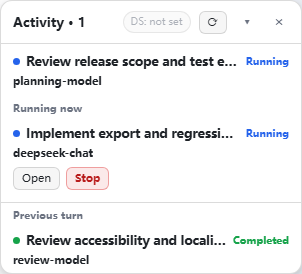

# Reproducible verification / 可复现验证

Run from this package directory:

```sh
npm ci --ignore-scripts
npm run check
npm test
npm run pack:smoke
```

`check` parses the production Host/client/routing and demo source. Tests use Node's built-in runner without a build system. The inherited panel suite contains 47 cases; the inherited routing suite contains 13 scenarios, adapted to package-local generic routes and in-memory diagnostics. Release tests exercise localization, settings guards/races and missing-service behavior. Test counts are scenarios, not coverage percentages.

`pack:smoke` makes a real tarball in the ignored `.pack-smoke` directory, reads its tar members with Node built-ins, rejects unexpected/private file paths, extracts only safe regular entries under that directory, imports the packed Host/routing module, and checks package metadata. Public Schemastery is a declared runtime dependency. React/ReactDOM are demo-only dev dependencies; the production client receives React from DSH.

No live profile, credentials, user session, state, backup, ASAR module, real browser or model request is accessed by these tests. No true ConfigEditor persistence/restart test is claimed. The old installed-Electron test was intentionally not copied: it depended on an author's absolute path and installed archive. Official ConfigEditor guards were reviewed, but these fixtures are not a substitute for integration verification.

## Synthetic screenshots

The source-only [demo page](../demo/index.html) loads the **actual production client bundle**, local React UMD scripts from dev dependencies, and explicit synthetic remote/locale fixtures. It makes no API request and cannot Stop real work. It is excluded from npm publication.

After `npm ci`, serve this package directory using an existing authorized static-preview server (or open the page locally if your browser permits local scripts). The main verification thread is responsible for selecting the preview URL. **Do not replace or restart the running DSH server.** Example relative routes:

- `demo/index.html?lang=en&state=off`
- `demo/index.html?lang=zh-CN&state=on`
- `demo/index.html?lang=en&state=unconfigured`
- `demo/index.html?lang=zh-CN&state=unavailable`

Use a viewport about 1440×1000 or larger so the compact 30vh body can show both sections, or scroll the panel. Browser screenshots were captured from these public fixtures in English OFF, Chinese ON and unconfigured states. Full views retain the synthetic disclaimer; cropped panel views have the same explicit caption in the README. They are not live DSH acceptance. The release check also toggles the real client switch against a synthetic Settings authority; it does not change a live profile.




## Remaining real acceptance checklist

- Isolated profile installation, bundle discovery, projection registration/replay and existing GUI refresh.
- Verify English/Chinese switching in the **DSH locale settings**, pinned panel locale and missing-locale fallback. Confirm title/aria and error states, not just main labels.
- Missing/stopped routing entry, unconfigured target, structurally invalid target, valid-looking but unknown provider/model and unauthorized exact target.
- Real Settings/ConfigEditor false→false, ON/OFF repetition, home/CLI refusal, stale revision, two-window updates, actual restart persistence, failed disabling and reconnect while saving.
- Confirm OFF exact spec/prompt pass-through and no preflight; ON only future spawn/fork/continuable creation; close while preflight succeeds/fails; existing children and continuation remain unchanged.
- Actual multimodal request support with an authorized target, with separately approved paid requests if necessary. Pricing/latency/cache effects are unmeasured.
- Main/direct-child grouping, previous-turn completion evidence, pending `next` vs actual `lastUsed`, native Open and permission-preserving Stop, collapsed feed cleanup.

The declared DSH 0.2.1-rc.2 engine is an intended API contract, not proof of live compatibility. The local preparation environment ran Windows Node 22.22.3; Node 24/Linux are CI targets until CI actually runs. Do not infer support for other DSH versions.
