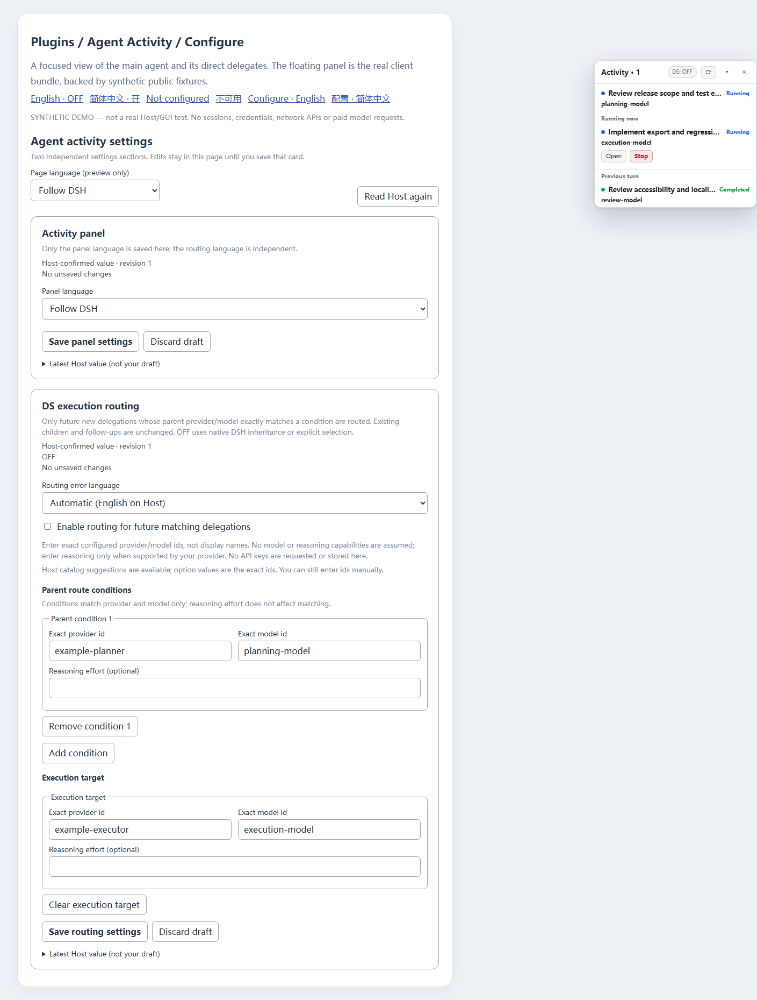
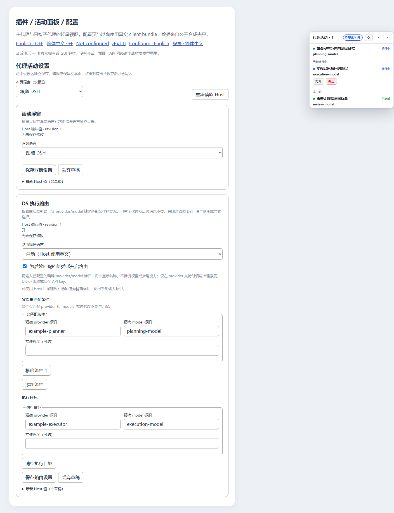

# Reproducible verification / 可复现验证

## Portable Node checks / 通用检查

Run from this package directory / 在本项目目录运行：

```sh
npm ci --ignore-scripts
npm run check
npm test
npm run pack:smoke
```

`check` parses the production Host/client/routing and demo source. Tests use Node's built-in runner without a build system. The original 47 panel + 13 routing scenarios remain; release and configuration-page tests cover localization, validation, independent card saves, dirty-draft conflicts, revision fencing, reset/unmount races and missing services. Counts are scenarios, not coverage percentages. The optional Host integration test is explicitly **skipped** by normal `npm test` when `DSH_TEST_ROOT` is unset; a skip is not a passing Host test.

`pack:smoke` creates and inspects a real tarball in ignored `.pack-smoke`, allowlists members, extracts safe regular files and imports the packed Host/routing modules. No tests, demo adapters, local artifacts, secrets or official DSH implementation are published in the npm tarball. The GitHub source includes portable tests and demo fixtures. Public Schemastery is a runtime dependency; React/ReactDOM are demo-only dev dependencies. Production React comes from DSH.

普通 Node 测试不访问现用 profile、凭据或会话，不发起模型调用。`pack:smoke` 检查真实 tarball、文件白名单及入口导入；公开源码含测试和 demo，安装 tarball 不包含这些开发夹具。未设置 `DSH_TEST_ROOT` 时宿主测试明确跳过，不能算成已通过的宿主验证。

## Optional real Settings/ConfigEditor integration / 可选真实配置服务测试

Use an independently supplied, **readable official DSH root containing `node_modules`**. This test dynamically imports official boot/Loader, Settings and ConfigEditor; no official implementation is copied into this repository. Node alone cannot read Electron ASAR virtual paths, so supply an extracted/source runtime with its dependencies when necessary. The caller is responsible for obtaining a legitimate compatible runtime.

PowerShell example (replace the placeholder with that runtime root):

```powershell
$env:DSH_TEST_ROOT = 'C:\path\to\readable\dsh'
npm run test:host
Remove-Item Env:DSH_TEST_ROOT
```

POSIX example:

```sh
DSH_TEST_ROOT=/path/to/readable/dsh npm run test:host
```

The test creates a new temporary home/profile under the OS temporary directory, loads the **actual repository plugin schemas and routing guard**, saves through real Settings/ConfigEditor, destroys and reboots the isolated Host, and verifies durable values. It never boots a user's normal profile. Injected projection/LLM/subagent dependencies prevent real delegation/model access. Cleanup validates the exact temporary directory before removing it.

Recorded verification used official Settings/ConfigEditor **0.2.1-rc.2** and passed seven subcases plus the parent test (**8 tests**):

1. Two namespaces, inherited OFF/unconfigured defaults.
2. Invalid unconfigured enable rejected before writing.
3. Complete exact routes, optional effort, language and enabled saved together.
4. Stale revision rejected without a file change.
5. Independent panel and routing locales.
6. Fresh official boot restores persisted settings.
7. A higher-priority home overlay rejects the lower-layer write without changing the profile patch.

这是隔离的真实官方配置服务测试，不是合成 Settings；但仍**不等于**安装后 DSH Web 的真实 RPC、插件页导航、权限撤销或桌面宿主端到端测试。测试代码不包含真实凭据，不调用模型，也不重启现用 DSH。官方版本升级后应重新运行。

## Synthetic browser configuration test / 合成浏览器配置页验证

The [demo page](../demo/index.html) loads the **actual production client bundle and React**, with explicit public Settings/locale/session/catalog adapters. It makes no API request, cannot Stop real work and is excluded from the install tarball. Open it locally in a browser that permits local scripts, or use an already authorized static-preview server. **Do not replace/restart the running DSH server just to run the demo.**

After `npm ci`, open:

- `demo/index.html?view=settings&lang=en`
- `demo/index.html?view=settings&lang=zh-CN&state=on`
- `demo/index.html?view=settings&lang=en&state=unconfigured`
- `demo/index.html?view=settings&lang=en&state=readonly`
- `demo/index.html?view=settings&lang=en&state=unavailable`
- `demo/index.html?view=settings&lang=en&state=no-catalog`

To reproduce the functional suite, open the first URL in a fresh tab, paste the async function expression from [browser-settings-spec.js](../test/browser-settings-spec.js) into DevTools, then invoke it as `(<expression>)()`. The test uses only `window.activityDemo` synthetic controls. It changes the demo's final state and should not be run in a real DSH page.

Recorded browser run: **46 assertions** on the actual production form/overlay, plus four state fixtures and a narrow-layout/label check. Assertions cover no writes on open/edit, exact-id suggestions, live bilingual draft retention, independent saves, complete routing patches, unsaved-versus-confirmed ON, overlay synchronization, invalid input, parent condition add/remove, external-update conflict/review, failed disable retaining ON, home-overlay rejection, reconnect/late receipt and readonly fields. External concurrent edits are simulated through the fixture authority; they are **not a claim of a live multi-window DSH test**. The narrow browser viewport actually measured 500 CSS pixels; no horizontal overflow was observed.

Recorded screenshots show real production UI backed by synthetic public data, **not live DSH acceptance**. The caption is retained on the page and in the documentation.




## Activity-only screenshots / 仅浮窗演示

- `demo/index.html?lang=en&state=off`
- `demo/index.html?lang=zh-CN&state=on`
- `demo/index.html?lang=en&state=unconfigured`
- `demo/index.html?lang=zh-CN&state=unavailable`

The original screenshots remain synthetic. A large viewport or scrolling is needed to show both current/previous sections within the compact 30vh overlay body.

## README gallery / 首页图集

The README uses three views in each language: the actual compact overlay, a three-state DS comparison, and the actual routing form. `demo/states.html?lang=zh-CN` or `?lang=en` renders three isolated iframe instances of the production demo for OFF/ON/unconfigured. The gallery only adjusts preview positioning and visible height; it does not create model requests or alter product behavior.

首页每种语言有三幅图：真实紧凑浮窗、DS 三态对比和真实路由表单。`demo/states.html` 用三个隔离 iframe 渲染生产组件的关闭／开启／未配状态；仅调整预览位置与可见高度，不创建模型请求。概览和配置图可用浏览器元素截图直接截取 `data-subagent-activity` 区域与路由表单；不需要个人会话或安装到现用 profile。

## Remaining real acceptance gates / 尚未完成的真实验收

- Install/discover the bundle in an isolated real DSH profile; verify plugin-detail navigation, slot lifecycle, projection registration and real RPC receipts.
- Verify real DSH locale changes, explicit panel language, permission revocation, missing-service behavior and cross-window updates through the actual transport.
- Verify profile readonly and home/CLI overlays in that installation; isolated persistence is already tested but is not a complete GUI chain.
- Verify actual fork/spawn/continuable tools, target resolution/authorization refusal, OFF pass-through, routing preflight races and unchanged existing children.
- Multimodal provider support and all paid model/billing/latency effects remain untested. Only run paid requests with separate explicit authorization.
- Main/direct-child grouping, previous-turn completion, actual `lastUsed`, native Open/Stop and collapsed-feed cleanup in the live installed Host.

The declared DSH 0.2.1-rc.2 engine is an intended API baseline, not universal compatibility certification. Normal CI runs Node 22/24 on Windows/Linux without a supplied official runtime; it does not turn an optional Host skip into evidence. 本次只更新开源项目，不覆盖本机维护版或配置，不重启 DSH。
